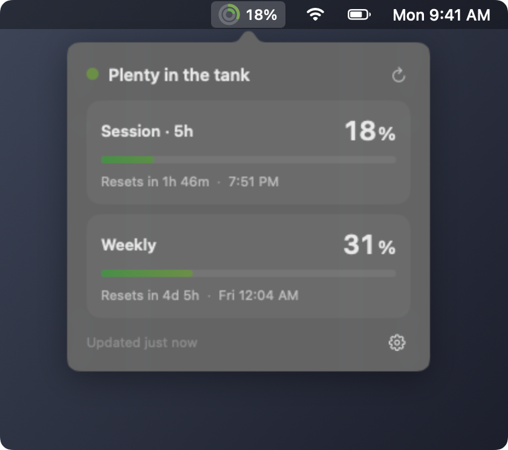
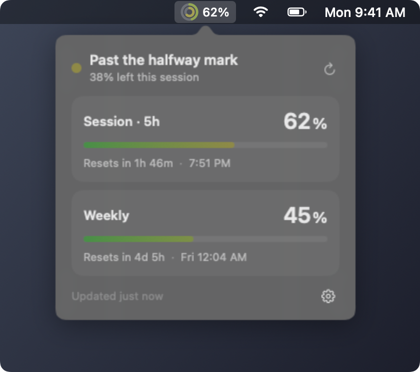
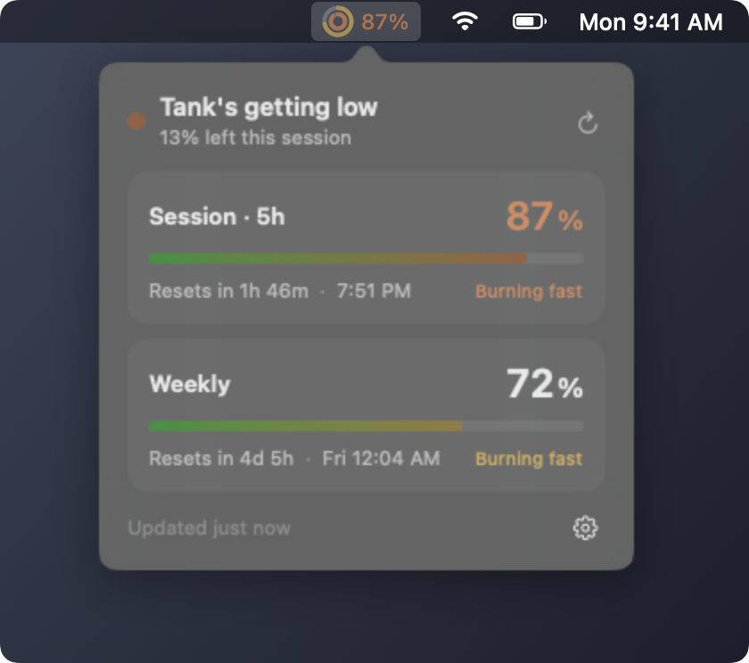
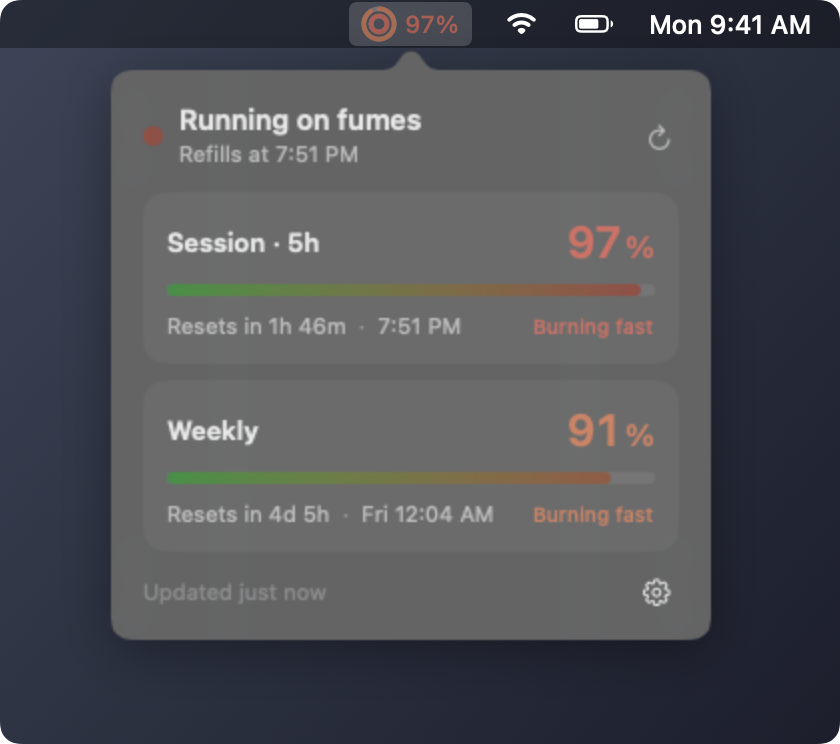

# TokenMeter

See your Claude usage limits from the macOS menu bar.

The outer ring is your weekly limit and the inner ring is your 5-hour session. They go from green to red as you use more. Click for the details.

<table>
  <tr>
    <td></td>
    <td></td>
  </tr>
  <tr>
    <td></td>
    <td></td>
  </tr>
</table>

## Install

```sh
git clone https://github.com/bubblebath99/tokenmeter.git && cd tokenmeter && ./install.sh
```

You need macOS 13 or later, Claude Code signed in with a Pro or Max plan, and the Xcode Command Line Tools (`xcode-select --install`).

To remove it: `./install.sh uninstall`

## How it works

Claude Code passes your current usage to its status line after every reply. The installer adds a small status line script that saves it to a file, and the app reads that file, so there are no extra network calls. If you already have a status line, it keeps working.

If the data gets old, the app asks Anthropic's usage endpoint directly, at most once every 15 minutes. Nothing else leaves your Mac.

Not affiliated with Anthropic. MIT license.
